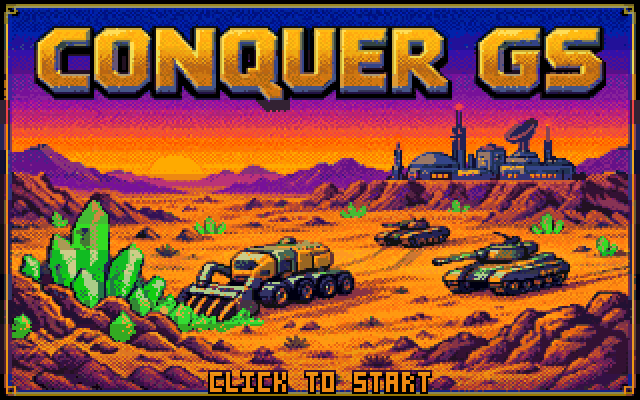
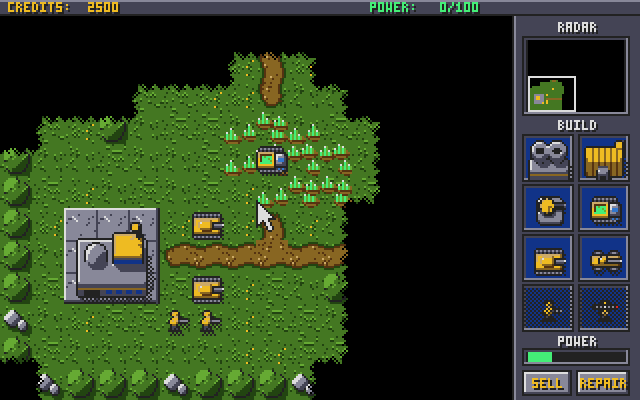
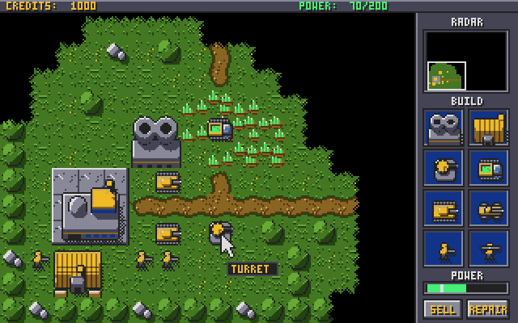
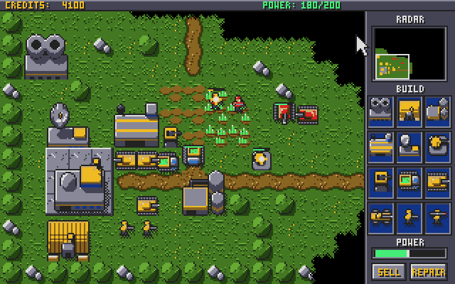
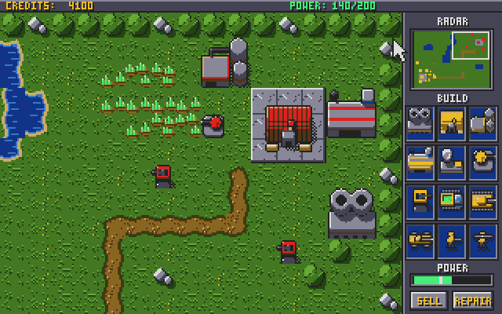
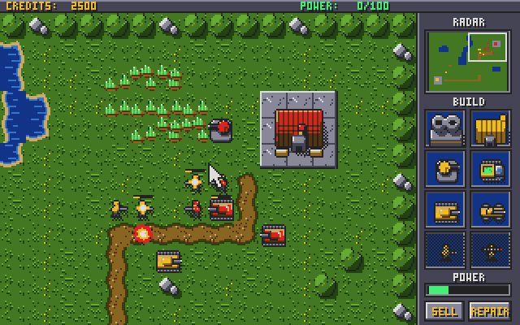
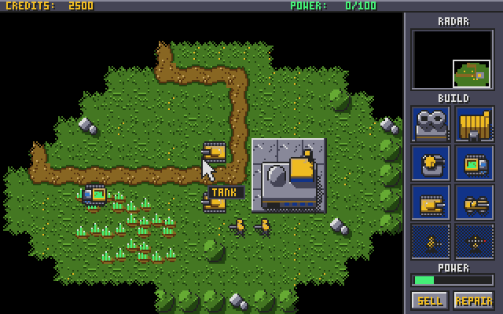
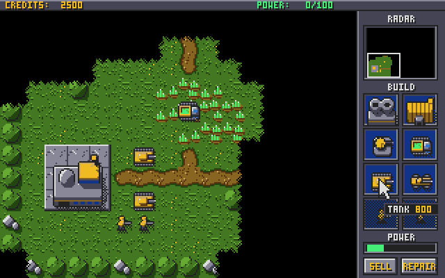
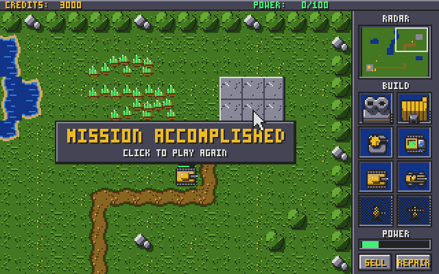
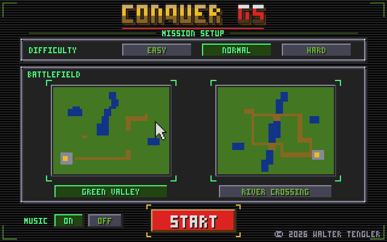

# Conquer GS

A real-time strategy game for the Apple IIgs in the spirit of Command &
Conquer, written from scratch in 65816 assembly. Build a base, harvest ore,
train an army and destroy the enemy, at 60 frames a second in Super Hi-Res,
with Ensoniq sound and music.

## Features

- **Base building:** a command center, power plants, barracks, a war
  factory, refineries, a radar center, gun turrets and guard towers. Place
  structures where you want them; sell or repair them.
- **Economy:** harvesters mine ore fields and bring the credits home, to
  the command center or the nearest refinery; mined-out ore grows back
  slowly. Power plants keep production at full speed.
- **Five kinds of units:** tanks, fast buggies, soldiers, rocket soldiers
  and the harvester, with weapons that are strong or weak against
  infantry, vehicles and buildings.
- **A computer opponent** with a base of its own that builds an army and
  attacks in waves, at three difficulties: easy, normal and hard. It
  mines ore with a harvester of its own; destroy that, or its war factory,
  refinery or power plant, to slow it down.
- **Four maps,** Green Valley, River Crossing, Twin Lakes and Stone Pass,
  with fog of war: you have to scout to find the enemy.
- **A scrolling battlefield** twice the size of the screen, with a radar
  that shows the whole world once you have built a radar center.
- **Original pixel art** in Super Hi-Res (320x200, 16 colors); units face the
  way they move.
- **Recorded weapon sounds and two original music tracks** on the Ensoniq
  sound chip.
- **Name tags:** rest the mouse on a unit, a building or a build icon to see
  what it is (and what it costs).

## Screenshots

| | |
|---|---|
|  |  |
| The start of a game on Green Valley: a command center and your first units | A base with a radar center, a refinery, a guard tower and a turret |
|  |  |
| The enemy attacks; the turret and the guard tower fire back | The enemy's base: barracks, war factory, refinery, power plant and guard towers |
|  |  |
| A fight at the enemy base | River Crossing: a refinery by the ore, with its name tag |
|  |  |
| Build icons show their name and price | Mission accomplished |

## Download and play

Download **conquer.po** from the
[Releases](https://github.com/portwally/conquer-gs/releases) page: an 800K
ProDOS disk that boots straight into the game.

**You need** an Apple IIgs (ROM 01 or ROM 3) with at least 1 MB of memory
and a mouse, or an emulator.

- **On a real IIgs:** write the disk image to a 3.5" disk, or use it with a
  FloppyEmu, BlueSCSI or similar device, and boot from it. The game also
  finds its files in a folder on a hard disk: copy CONQUER.SYSTEM,
  CONQUER.DATA, CONQUER.SOUND, CONQUER.TITLE and CONQUER.HELP into one
  folder and start CONQUER.SYSTEM.
- **In MAME** (on a Mac, easiest through [Ample](https://github.com/ksherlock/ample)):
  choose the Apple IIgs (ROM 3 or ROM 01) with 1 MB of memory or more (2 MB
  is the default), put conquer.po in the first 3.5" drive and start it.

The game has been tested in MAME. It takes a little while to load (the
screen says LOADING and counts along with dots); then the title appears
with its music.

### The mouse in MAME

MAME turns a modern mouse's movement into many more counts than an Apple
mouse makes, so the arrow races and big moves overflow. `run.sh` sets
MAME's mouse sensitivity to 40% for the IIgs (`MOUSESPEED=30 ./run.sh`
for slower, `60` for faster). In Ample, or MAME started some other way,
press Tab in the running machine, choose Analog Controls and set Mouse X
and Mouse Y Sensitivity to about 40.

## How to play

**Your goal:** destroy every enemy unit and building. You lose if your
command center is destroyed. After a game, click the banner to play again.
To stop for a moment, press Esc: the pause panel also lists the controls, and from there you can quit the mission.

### Starting a game

Click (or press a key) on the title. On the mission setup screen choose:

- **Difficulty:** easy, normal or hard.
- **Map:** one of four, picked with the arrows on either side of the
  preview (or a click on the map for the next one). The preview shows your
  base as a gold dot; where the enemy is, you find out by scouting.
- **Music and effects:** the volume of each, off or in four steps (a click
  on the effects' buttons plays a sample of how loud they are).

Then click START or press RETURN. Your choices are kept for the next game.
HOW TO PLAY opens three pages of instructions: the mission, the controls,
the units and the enemy (NEXT and BACK to leaf through, Esc back to the
setup).

### Controls

| To... | Do this |
|---|---|
| Select a unit | Click it |
| Select several units | Drag a box around them |
| Unselect | Space (or drag a box over empty ground) |
| Move | With units selected, click open ground (a green cross) |
| Attack | With units selected, click an enemy (a red cross) |
| Scroll the view | Arrow keys, or hold the mouse at an edge of the screen |
| Jump to a place | Click it on the radar (with a radar center) |
| Build | Click an icon in the sidebar; click a unit's icon again to queue more of it (up to 5, the number shows on the icon) |
| Cancel a build | Option-click (or Apple-click) its icon: one fewer queued, or the build stops; the money comes back |
| Set a rally point | Click your barracks or war factory, then open ground: its new units walk there |
| Place a structure | When it says READY, click the icon again, then a spot where the outline is green |
| Sell or repair | Click SELL or REPAIR, then one of your structures; click the button again to stop |
| See what something is | Rest the mouse on it |
| Cancel placing a structure, selling or repairing | Space |
| Pause (and see the controls) | Esc; then RESUME (or Esc, Space, RETURN) or QUIT MISSION (or Q) to go back to the mission setup |
| Turn the music off or on | M |

### Economy and power

- You start with 2500 credits and a command center, plus a few units. Your
  harvester mines the nearest ore on its own (25 credits a scoop, 500 a
  load) and unloads at the nearest dock: the one next to your command
  center, or the one in front of a refinery. Click an ore field to send it
  there, or elsewhere to park it.
- Each ore tile holds 600 credits. Mined-out ore grows back: about every
  half minute each tile gets 75 credits more, until it is full again. A
  harvester that finds no ore waits and looks again every few seconds.
- A refinery comes with a harvester of its own. Build it near the ore and
  the trips get shorter.
- Structures, infantry, vehicles and harvesters build in four separate
  queues, one of each at a time: a soldier from the barracks, a tank from
  the war factory, a harvester from the command center and a structure can
  all be under way at once. Up to 5 units of one kind can wait in a
  queue. The cost is paid up front (and given back if you cancel); a bar
  under the icon shows the progress.
- Your command center makes 100 power and each power plant 100 more. The
  other structures use power; the top bar shows what is used and what is
  made. With too little power everything builds at half speed and the
  radar goes off.
- Structures go on open ground (not on ore or a dock) within 4 tiles of one
  of your buildings.
- Selling gives you half the price back. Repairing costs 3 credits for every
  4 hit points.

### Units

Tanks and buggies come out of a war factory, soldiers out of a barracks;
without one, their icons are greyed out. Harvesters need nothing: they come
from the command center. A war factory can only be built once you have a
barracks.

| Unit | Cost | Build time | Hit points | Range | Weapon | |
|---|---:|---:|---:|---:|---|---|
| Tank | 800 | 8 s | 120 | 3 | cannon, 15 | needs a war factory |
| Buggy | 300 | 5 s | 90 | 2 | machine gun, 5, rapid fire | fast; needs a war factory |
| Soldier | 100 | 3 s | 40 | 2 | rifle, 6 | needs a barracks |
| Rocket soldier | 300 | 5 s | 30 | 4 | rockets, 15, slow to reload | needs a barracks |
| Harvester | 1000 | 10 s | 400 | | | mines ore; comes from the command center |

### Structures

| Structure | Cost | Build time | Size | Power | |
|---|---:|---:|---|---:|---|
| Power plant | 300 | 6 s | 2x2 | +100 | |
| Barracks | 500 | 8 s | 2x2 | -30 | trains soldiers |
| Refinery | 1500 | 10 s | 2x2 | -30 | a dock for harvesters; comes with one |
| War factory | 1000 | 10 s | 2x2 | -30 | builds vehicles; needs a barracks |

| Radar center | 800 | 8 s | 2x2 | -40 | turns the radar on |
| Turret | 600 | 8 s | 1x1 | -40 | 200 hit points, cannon 20, range 4 |
| Guard tower | 400 | 5 s | 1x1 | -10 | 150 hit points, machine gun 6, range 3 |

### Weapons and armor

- **Cannons and rifles** do full damage to everything.
- **The machine gun** does double damage to infantry, but only a quarter to
  vehicles and buildings.
- **Rockets** do double damage to vehicles and 1.5 times to buildings, but
  little to infantry.

### The enemy

The enemy has a base like yours: a barracks for its soldiers and rocket
soldiers, a war factory for its tanks and buggies, a refinery, a power
plant, a turret and guard towers. It sends its units against your base in
waves that grow bigger over time; its starting units stay home and defend.
Its money comes from its harvester, which mines the ore near its base and
unloads at its refinery. Destroy the harvester and its income stops until
the refinery has made a new one, which takes 30 seconds (and it builds
nothing else meanwhile). Without its war factory it builds no more
vehicles, without its refinery it earns nothing, and without its power
plant it builds at half speed. But it rebuilds what you destroy, on the
same spot, once it has the money and the spot is clear: the refinery
first, then the power plant, the war factory and the barracks. Each takes
it 15 to 25 seconds.

| | Easy | Normal | Hard |
|---|---|---|---|
| Its first attack after | 3 minutes | 2 minutes | 90 seconds |
| Then attacks at least every | 80 seconds | 60 seconds | 45 seconds |
| Units in an attack | 2 to 4 | 3 to 5 | 3 to 6 |
| Its share of each load its harvester brings in | 16% | 24% | 36% |

### Fighting

Armed units fire at enemies in range on their own, and units on the move
shoot at what they pass without stopping. When the mission ends, a panel
shows how it went: units built and lost, enemy units and buildings
destroyed, ore mined and the time played.

### Tips

- Send a unit ahead to scout: the fog hides the enemy until you have seen
  it.
- A couple of turrets next to your command center hold off the early
  attacks; guard towers are cheap and good against soldiers.
- Rocket soldiers are best against tanks and buildings, the buggy's machine
  gun against soldiers.
- Keep your harvester safe: without it there are no credits. A refinery
  near the ore brings in money faster.
- Hunt the enemy's harvester: it has 400 hit points, so rockets or a few
  tanks are best, and every time you destroy one the enemy goes without
  income for a while.
- Build a power plant before you run short of power: the radar needs it.

## Credits

- Game, graphics and music: © 2026 Walter Tengler
- Weapon sounds (CC0): a Mosin Nagant rifle shot and a PPSh burst from "The
  Free Firearm Sound Library" by Ben Jaszczak, Brian Nelson, Kevin Heras and
  Matthew Nanney, and "cannon fire" by Thimras, both from OpenGameArt
  (details in [assets/sounds/CREDITS.txt](assets/sounds/CREDITS.txt))
- The disk boots ProDOS 2.4.3. The game is built with Merlin 32 and Cadius
  and tested in MAME.

## For developers

- [Building the game](docs/BUILDING.md): the tools, building the disk,
  running it in MAME, and the test scripts.
- [How it works](docs/TECHNICAL.md): the memory layout, rendering,
  pathfinding, the enemy AI, sound and music, the art and performance.
